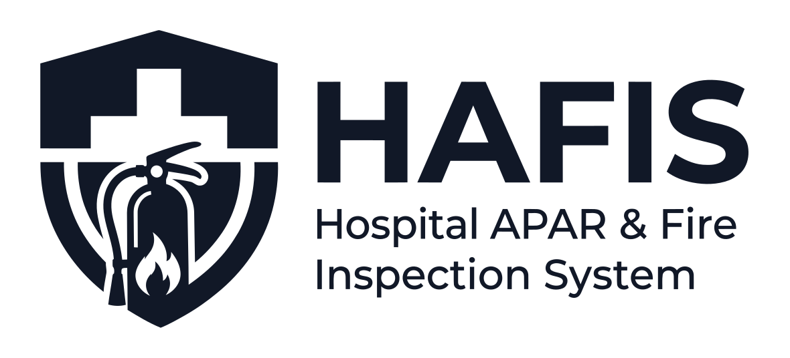
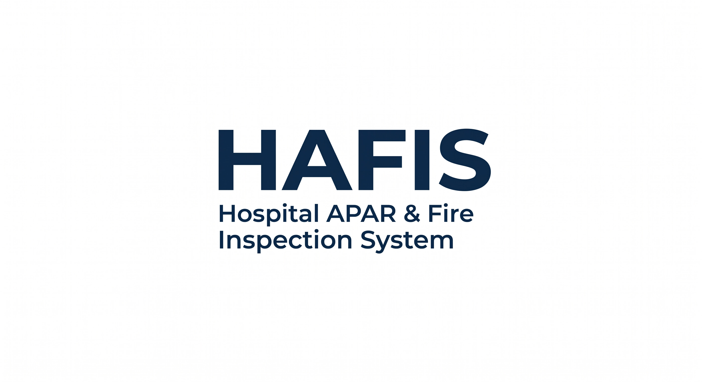
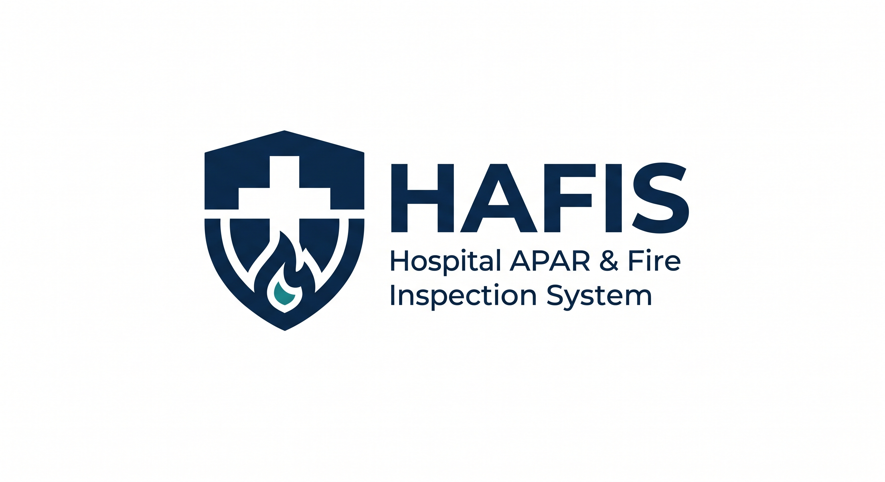

<p align="center">
  
</p>

<p align="center">
  <strong>Hospital APAR & Fire Inspection System</strong><br>
  Sistem Digitalisasi Inspeksi, Manajemen Aset Proteksi Kebakaran & Tagging QR Code Terpadu<br>
  <strong>Instalasi K3RS • RSUD dr. H. Moch. Ansari Saleh Banjarmasin</strong>
</p>

<p align="center">
  
  
  
  
  
</p>

---

## 📌 Gambaran Umum

**HAFIS** (*Hospital APAR & Fire Inspection System*) adalah platform digital operasional yang dikembangkan khusus untuk **Instalasi Keselamatan dan Kesehatan Kerja Rumah Sakit (K3RS) RSUD dr. H. Moch. Ansari Saleh Banjarmasin**. 

Sistem ini menggantikan pencatatan kartu gantung manual dengan ekosistem digital terpadu: mulai dari penerbitan stiker QR Code fisik tabung, pemindaian kamera mobile oleh petugas di lapangan, pencatatan checklist 7 parameter fisik APAR, hingga audit trail penggantian tabung dan rekapitulasi kepatuhan akreditasi rumah sakit (Standar MFK KARS/SNARS).

---

## 🖼️ Antarmuka Sistem

<p align="center">
  
</p>

<p align="center">
  
  
</p>

---

## ⚡ Fitur Utama

### 1. Label Stiker Aset Standar Resmi (*Official Hospital Safety Asset Tag*)
* **Multi-Format Cetak**: Mendukung cetak 1 stiker (kiri atas), 2 stiker (paruh atas), dan format pas label thermal.
* **Cetak Massal A4 (4 Stiker per Lembar)**: Otomatis membagi armada APAR ke dalam kuadran simetris ($105 \times 148.5\text{ mm}$) dengan panduan potong silang presisi (`✂ POTONG`) dan jarak aman bebas benturan.
* **Filter Dinamis Terintegrasi**: Tombol cetak langsung menyaring unit berdasarkan pencarian teks hierarkis gedung/ruangan maupun dropdown lokasi K3RS.
* **Ekspor Resolusi Tinggi**: Generator bawaan untuk mengunduh stiker format PNG HD 300 DPI dan format vektor SVG asli.

### 2. Inspeksi Lapangan & Scanner QR Kamera Mobile
* **Akses Cepat di Smartphone**: Petugas K3RS cukup memindai stiker QR pada tabung menggunakan kamera browser tanpa perlu memasang aplikasi pihak ketiga.
* **Checklist Fisik 7 Titik Parameter**:
  1. Kondisi Tabung (karat, penyok, kebersihan).
  2. Pin Pengaman & Segel Utuh.
  3. Selang / Hose (kelenturan, retak).
  4. Corong / Nozzle (kebersihan, sumbatan).
  5. Jarum Manometer / Pressure Gauge (zona hijau).
  6. Berat Media Pemadam (sesuai spesifikasi tara).
  7. Posisi Pemasangan (ketinggian 120–140 cm, bebas halangan).

### 3. Hierarki Lokasi Gedung Rumah Sakit
* Struktur lokasi terstandarisasi 3 tingkat: **Gedung $\rightarrow$ Lantai $\rightarrow$ Ruangan / Area Detail**.
* Sinkronisasi cascading dropdown secara real-time saat penempatan tabung baru maupun pemindahan unit APAR.

### 4. Siklus Hidup & Jejak Penggantian (*Replacement Audit Trail*)
* Alur penggantian resmi ketika tabung rusak, tekanan turun, atau mendekati masa kadaluarsa (EXP).
* Mendukung penggantian dengan kode identitas baru maupun pemindahan stiker lama (*same-code replacement*) dengan riwayat audit utuh.

### 5. Kepatuhan Regulasi K3RS & Pelaporan
* Formulir dan rekapitulasi data dirancang mengacu pada **Permenaker No. 04/MEN/1980** tentang Syarat-Syarat Pemasangan dan Pemeliharaan APAR.
* Memenuhi instrumen Manajemen Fasilitas dan Keselamatan (MFK) akreditasi rumah sakit Kementerian Kesehatan & KARS.

---

## 🛠️ Arsitektur & Teknologi

| Komponen | Spesifikasi | Keterangan |
| :--- | :--- | :--- |
| **Framework** | Laravel 12.x | Backend engine & REST controller |
| **Bahasa** | PHP 8.5+ | Typed properties, match expressions, modern syntax |
| **Styling** | Tailwind CSS v4 & Alpine.js | Desain antarmuka berstandar hospital design system |
| **QR Code Engine** | BaconQrCode & HTML5 Canvas | Render SVG murni dan rasterisasi 300 DPI |
| **Testing Suite** | PHPUnit 11 | Feature tests untuk master data, alur ganti, & cetak massal |
| **Code Standard** | Laravel Pint | Penataan format kode otomatis standar PSR-12 |

---

## 🚀 Panduan Instalasi Lokal

### Prasyarat Sistem
* PHP $\ge$ 8.5 (dengan ekstensi `pdo`, `mbstring`, `openssl`, `xml`, `gd` / `imagick`)
* Composer $\ge$ 2.7
* Node.js $\ge$ 20.x & NPM

### Langkah Instalasi

1. **Clone Repository**
   ```bash
   git clone https://github.com/loona/aparcek-8.git
   cd aparcek-8
   ```

2. **Pasang Dependensi Backend & Frontend**
   ```bash
   composer install
   npm install
   ```

3. **Konfigurasi Environment**
   ```bash
   cp .env.example .env
   php artisan key:generate
   ```

4. **Jalankan Migrasi & Seeder Basis Data**
   ```bash
   php artisan migrate --seed
   ```

5. **Build Aset Frontend**
   ```bash
   npm run build
   ```

6. **Jalankan Server Lokal**
   ```bash
   php artisan serve
   ```
   Aplikasi dapat diakses melalui peramban di: `http://127.0.0.1:8000`

---

## 🧪 Pengujian Otomatis

Seluruh logika bisnis, cascading lokasi, filter pencarian gedung, dan layout cetak A4 dilindungi oleh automated feature test:

```bash
# Menjalankan seluruh pengujian
php artisan test

# Menjalankan pengujian spesifik master data & cetak QR
php artisan test --filter=AparMasterDataTest

# Memeriksa dan memformat standar kode
vendor/bin/pint --format agent
```

---

## 👥 Pengguna & Hak Akses

| Peran (*Role*) | Akses & Wewenang |
| :--- | :--- |
| **Kepala / Admin K3RS** | Master Data APAR, cetak stiker massal, konfigurasi checklist, manajemen user, dan ekspor laporan keselamatan. |
| **Petugas Lapangan / Inspector** | Akses cepat scanner QR kamera, pengisian form checklist inspeksi bulanan, dan pengajuan penggantian unit. |

---

## 🏛️ Institusi

Dikembangkan dan diterapkan untuk operasional keselamatan proteksi kebakaran di:
* **Rumah Sakit**: RSUD dr. H. Moch. Ansari Saleh Banjarmasin
* **Unit Kerja**: Instalasi Keselamatan dan Kesehatan Kerja Rumah Sakit (K3RS)
* **Wilayah**: Pemerintah Provinsi Kalimantan Selatan

---

<p align="center">
  <small>© 2026 HAFIS — Hospital APAR & Fire Inspection System. RSUD dr. H. Moch. Ansari Saleh.</small>
</p>
