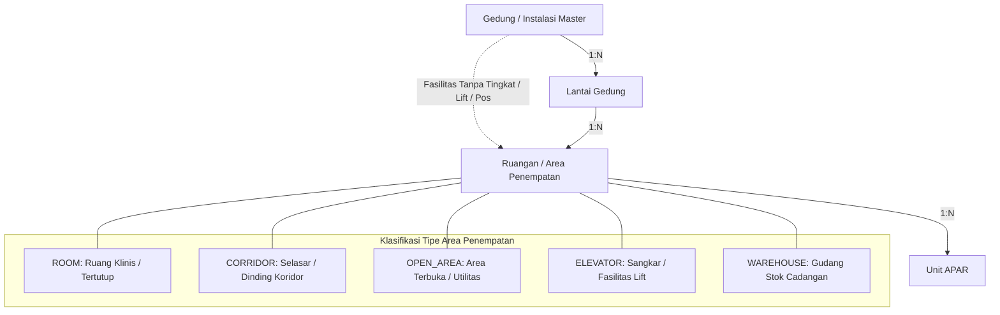
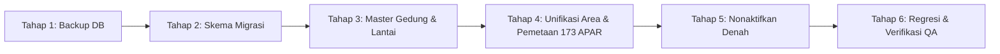

# HAFIS V6 — PHASE 2C.0: MASTER LOCATION & APAR DATA RECONCILIATION AUDIT
**Sistem Informasi Proteksi Kebakaran dan Pemantauan APAR Rumah Sakit (HAFIS)**  
**RSUD dr. H. Moch. Ansari Saleh Banjarmasin**

- **Dokumen Referensi:** `docs/V6_PHASE_2C_0_MASTER_DATA_RECONCILIATION_AUDIT.md`  
- **Tanggal Audit:** 3 November 2026  
- **Auditor:** Senior Laravel Engineer, Database Auditor, Data Migration Specialist & QA Reviewer  
- **Mode Eksekusi:** STRICT READ-ONLY AUDIT (Zero Code Mutation / Zero Database Mutation)  
- **Target Repositori:** `C:\laragon\www\aparcek-8` (Active Workspace) & `C:\laragon\www\aparcek-6` (Reference Repository)  
- **Status Audit:** SELESAI (`VERIFIED`)

---

## 1. EXECUTIVE SUMMARY

Audit Fase 2C.0 dilakukan secara independen dan mendalam untuk merekonsiliasi inventaris fisik APAR dan struktur lokasi master rumah sakit berdasarkan dokumen resmi terbaru: `triwulan/Data apar Gedung-Lantai-Ruangan.docx` (diterbitkan 3 November 2026) terhadap basis data aktif SQLite HAFIS (`database/database.sqlite`).

### Temuan Utama Audit:
1. **Rekonsiliasi Aritmetika Dokumen Sumber (100% `VERIFIED`):**  
   Dokumen sumber `Data apar Gedung-Lantai-Ruangan.docx` memuat **83 baris tabel** yang terdiri dari 2 baris header, 20 seksi gedung/instalasi, 60 baris rincian data ruangan/area, dan 1 baris total akhir. Seluruh perhitungan matematis pada dokumen sumber terbukti **100% konsisten tanpa selisih (0 discrepancy)**:
   - **Total Unit Terpasang Operasional:** 173 unit (115 Powder, 58 CO2).
   - **Total Stok Sediaan di Gudang K3RS:** 64 unit (Powder 6 kg).
   - **Total Keseluruhan Inventaris:** 237 unit.
   - Rincian kapasitas: Powder 25 kg = 3 unit, Powder 6 kg = 172 unit (108 operasional + 64 stok), Powder 3 kg = 4 unit, CO2 7 kg = 17 unit, CO2 5 kg = 7 unit, CO2 3 kg = 34 unit.
2. **Kesesuaian Data Operasional terhadap Basis Data Aktif (`VERIFIED`):**  
   Tepat **173 unit APAR operasional** yang terdaftar di basis data aktif memiliki kesesuaian **100% identik** dalam jenis media dan kapasitas terhadap 59 titik operasional pada dokumen sumber. Tidak ada selisih jumlah unit operasional maupun distribusi media antara data fisik lapangan dan basis data. 64 unit di Gudang K3RS berstatus cadangan/stok gudang (bukan APAR terpasang di dinding/koridor rumah sakit).
3. **Kesenjangan Arsitektur Lokasi Basis Data (`DISCREPANCY`):**  
   - Pada repositori aktif `aparcek-8`: Seluruh 173 unit APAR terpasang masih terkunci pada anomali `ruangan_id = 1` (`Ruang IGD`) akibat batasan `ruangan_id NOT NULL` pada skema lama.
   - Pada repositori `aparcek-6`: Telah dilakukan migrasi Fase 2B yang membuat `ruangan_id` nullable (14 unit di ruang klinis, 159 unit `null`), namun sistem masih mempertahankan dua model lokasi paralel (`lokasis` flat 64 titik vs `ruangans` 9 titik).
   - Pada Gedung Diagnostik: Dokumen sumber secara tegas menetapkan pembagian 2 lantai (Lantai 1: Radiologi [5 unit] & Poli ESWL [1 unit]; Lantai 2: Laboratorium [3 unit]). Di kedua basis data saat ini, Gedung Diagnostik hanya memiliki 1 lantai (`nomor_lantai = 1`), dan Ruang Laboratorium keliru ditempatkan di Lantai 1.
4. **Audit Dampak Penghapusan Fitur Denah Interaktif (`FEASIBLE / SAFE`):**  
   Fitur denah SVG interaktif dan penempatan pin koordinat (`PenempatanController`, `DenahController`, tabel `denahs`, kolom `koordinat_x`, `koordinat_y`) terisolasi dari alur kerja inti. Saat ini seluruh 173 APAR memiliki nilai koordinat `null`. Denah interaktif dapat dinonaktifkan/dihapus secara bertahap tanpa mengganggu inspeksi bulanan, pemindaian QR, pelaporan, atau riwayat pemeriksaan.
5. **Rekomendasi Strategi Migrasi:**  
   **GO WITH CONDITIONS.** Full database reset **TIDAK DIIZINKAN** karena akan memusnahkan identitas APAR (`kode`, `qr_code`), riwayat 7 pemeriksaan, 35 rincian temuan, dan stiker QR fisik yang telah terdistribusi di lapangan. Migrasi harus dilakukan dengan pendekatan **Controlled Reconciliation Migration**: menstandarkan 20 entitas gedung dan lantai, mengunifikasi entitas penempatan (`ruangans`/`lokasis`), menghubungkan 173 APAR ke gedung/lantai/area yang tepat, mendaftarkan 64 unit stok cadangan, serta mengamankan batas proteksi cetak/PDF dan QR print.

---

## 2. EXACT SOURCE FILES INSPECTED

Audit ini memeriksa secara langsung berkas-berkas berikut di lingkungan lokal:

| No | Berkas Sumber | Ukuran / Waktu Modifikasi | Deskripsi & Peran | Status Verifikasi |
|---:|---|---|---|:---:|
| 1 | `triwulan/Data apar Gedung-Lantai-Ruangan.docx` (di `aparcek-8`) | 38,403 bytes<br>03-Nov-2026 09:59:14 | **Referensi Primer:** Rekap resmi inventaris APAR K3RS Triwulan III 2026 berjenjang Gedung-Lantai-Ruangan. | `VERIFIED` |
| 2 | `triwulan/DATA GEDUNG.docx` (di `aparcek-6`) | 19,347 bytes<br>28-Oct-2026 08:27:51 | Dokumen pemetaan flat 64 titik K3RS terdahulu (tanpa data lantai & kapasitas). | `VERIFIED` |
| 3 | `triwulan/LAPORAN TRIWULAN KE-3 2026.docx` (di `aparcek-8` & `aparcek-6`) | 1,636,513 bytes<br>07-Oct-2026 10:51:54 | Dokumen naratif laporan triwulan K3RS. Tabel 12 memuat rekap awal 64 lokasi (239 unit lama). | `VERIFIED` |
| 4 | `database/database.sqlite` (di `aparcek-8`) | 405,504 bytes<br>03-Nov-2026 09:32:16 | Basis data aktif SQLite (skema Fase 1D/5 UI). | `VERIFIED` |
| 5 | `database/database.sqlite` (di `aparcek-6`) | 458,752 bytes<br>02-Nov-2026 13:33:36 | Basis data referensi SQLite (skema pasca-Fase 2B). | `VERIFIED` |
| 6 | `docs/CURRENT_SYSTEM_LOCATION_AUDIT.md` (di `aparcek-8`) | 44,046 bytes<br>31-Oct-2026 | Laporan komprehensif audit lokasi Fase 1D. | `VERIFIED` |
| 7 | `docs/V6_PHASE_2B_IMPLEMENTATION_REPORT.md` (di `aparcek-6`) | 24,190 bytes<br>02-Nov-2026 | Laporan implementasi arsitektur Hybrid Option C Fase 2B. | `VERIFIED` |
| 8 | `docs/V6_PHASE_2B_5_POST_IMPLEMENTATION_AUDIT.md` (di `aparcek-6`) | 28,450 bytes<br>02-Nov-2026 | Laporan verifikasi pasca-implementasi Fase 2B. | `VERIFIED` |
| 9 | `docs/V6_PHASE_2A_1_LOCATION_MAPPING_VALIDATION.md` (di `aparcek-6`) | 32,100 bytes<br>01-Nov-2026 | Dokumen validasi pemetaan 64 titik lokasi terhadap denah fisik. | `VERIFIED` |
| 10 | Berkas Kode Aplikasi & Skema Migrasi | Seluruh migrasi, controller, model, view Blade, dan route di kedua repositori | Evaluasi ketergantungan model denah, lokasi, dan validasi APAR. | `VERIFIED` |

---

## 3. SOURCE DOCUMENT ROW COUNTS & ARITHMETIC RECONCILIATION

Berdasarkan ekstraksi XML langsung dari `Data apar Gedung-Lantai-Ruangan.docx` (Word processing ML `w:tbl`):
- **Jumlah Kolom Grid:** 11 kolom:
  - Kolom 0: `No`
  - Kolom 1: `Gedung / Lantai`
  - Kolom 2: `Ruangan`
  - Kolom 3: `Powder 25 kg`
  - Kolom 4: `Powder 6 kg`
  - Kolom 5: `Powder 3 kg`
  - Kolom 6: `CO2 7 kg`
  - Kolom 7: `CO2 5 kg`
  - Kolom 8: `CO2 3 kg`
  - Kolom 9: `Jumlah`
  - Kolom 10: `Kondisi`
- **Total Baris XML:** 83 baris:
  - Header tabel: 2 baris (Baris 0 dan 1)
  - Seksi Gedung / Subtotal: 20 baris
  - Baris Detail Ruangan/Area: 60 baris (No 1 s.d. 60)
  - Baris Total Akhir: 1 baris (Baris 82)

### Hasil Uji Konsistensi Aritmetika:
1. **Uji Penjumlahan Kolom per Baris (Detail Rows Sum):**  
   Untuk seluruh 60 baris detail, nilai `Jumlah` (Kolom 9) dihitung ulang:  
   $$\text{Jumlah} = P_{25} + P_{6} + P_{3} + C_{7} + C_{5} + C_{3}$$  
   **Hasil:** 60 dari 60 baris **100% TEPAT**. Selisih = **0 baris**.
2. **Uji Penjumlahan Subtotal Gedung (Building Subtotals Sum):**  
   Untuk seluruh 20 seksi gedung, nilai subtotal per kolom dan total jumlah dibandingkan dengan akumulasi baris rincian di bawahnya.  
   **Hasil:** 20 dari 20 seksi gedung **100% TEPAT**. Selisih = **0 seksi**.
3. **Uji Penjumlahan Total Akhir (Grand Total Sum):**  
   - Akumulasi baris rincian: $[P_{25}=3, P_{6}=172, P_{3}=4, C_{7}=17, C_{5}=7, C_{3}=34] \rightarrow \text{Grand Total} = \mathbf{237}$.
   - Nilai tercetak pada baris `TOTAL AKHIR`: $[3, 172, 4, 17, 7, 34] \rightarrow \text{Jumlah} = \mathbf{237}$.  
   **Hasil:** **100% RECONCILED**.

---

## 4. VERIFIED TOTALS BY BUILDING, FLOOR, AND ROOM

Berikut adalah data lengkap 20 seksi gedung, lantai, dan 60 ruangan/area hasil ekstraksi dan verifikasi mandiri:

| No | Seksi Gedung / Instalasi | Lantai Dokumen | Ruangan / Area Sumber | P 25 | P 6 | P 3 | C 7 | C 5 | C 3 | Subtotal | Status / Kondisi | Kategori Operasional |
|---:|---|---|---|:---:|:---:|:---:|:---:|:---:|:---:|:---:|---|---|
| **-** | **POS SECURITY** | | | **0** | **1** | **0** | **0** | **0** | **0** | **1** | | **Seksi 1** |
| 1 | POS SECURITY | `-` | POS PANTAU SECURITY | 0 | 1 | 0 | 0 | 0 | 0 | 1 | Baik/Terisi | Pos Keamanan Luar |
| **-** | **1. GEDUNG INSTALASI RAWAT JALAN** | | | **0** | **15** | **0** | **3** | **0** | **3** | **21** | | **Seksi 2** |
| 2 | GEDUNG INSTALASI RAWAT JALAN | `Lt 1 (Poliklinis)` | IRJA Lt. 1 | 0 | 6 | 0 | 0 | 0 | 0 | 6 | Baik/Terisi | Koridor / Area Pelayanan |
| 3 | GEDUNG INSTALASI RAWAT JALAN | `Lt 1 (Poliklinis)` | KASIR | 0 | 1 | 0 | 0 | 0 | 0 | 1 | Baik/Terisi | Ruang Pelayanan Tertutup |
| 4 | GEDUNG INSTALASI RAWAT JALAN | `Lt 1 (Poliklinis)` | REKAM MEDIS | 0 | 1 | 0 | 0 | 0 | 2 | 3 | Baik/Terisi | Ruang Arsip Klinis |
| 5 | GEDUNG INSTALASI RAWAT JALAN | `Lt 1 (Poliklinis)` | FISIOTERAPI | 0 | 0 | 0 | 1 | 0 | 0 | 1 | Baik/Terisi | Ruang Terapi Klinis |
| 6 | GEDUNG INSTALASI RAWAT JALAN | `Lt 2 (Manajemen)` | IRJA LT 2 | 0 | 2 | 0 | 0 | 0 | 0 | 2 | Baik/Terisi | Koridor Manajemen |
| 7 | GEDUNG INSTALASI RAWAT JALAN | `Lt 2 (Manajemen)` | RESEPCIONIST Lt 2 | 0 | 1 | 0 | 0 | 0 | 0 | 1 | Baik/Terisi | Area Informasi |
| 8 | GEDUNG INSTALASI RAWAT JALAN | `Lt 2 (Manajemen)` | KOMITE MEDIK | 0 | 1 | 0 | 0 | 0 | 0 | 1 | Baik/Terisi | Ruang Rapat / Komite |
| 9 | GEDUNG INSTALASI RAWAT JALAN | `Lt 2 (Manajemen)` | AUDITORIUM | 0 | 1 | 0 | 1 | 0 | 0 | 2 | Baik/Terisi | Aula Pertemuan |
| 10 | GEDUNG INSTALASI RAWAT JALAN | `Lt 2 (Manajemen)` | MANAJEMEN + Rg ARSIP KEPEGAWAIAN | 0 | 2 | 0 | 1 | 0 | 1 | 4 | Baik/Terisi | Ruang Kantor & Arsip |
| **-** | **2. GEDUNG IGD** | | | **0** | **5** | **0** | **0** | **0** | **2** | **7** | | **Seksi 3** |
| 11 | GEDUNG IGD | `Lt 1` | IGD Lt. 1 | 0 | 3 | 0 | 0 | 0 | 1 | 4 | Baik/Terisi | Ruang Gawat Darurat |
| 12 | GEDUNG IGD | `Lt 1` | STROKE CENTER | 0 | 1 | 0 | 0 | 0 | 1 | 2 | Baik/Terisi | Ruang Perawatan Kritis |
| 13 | GEDUNG IGD | `Lt 1` | 119 | 0 | 1 | 0 | 0 | 0 | 0 | 1 | Baik/Terisi | Posko Layanan Darurat |
| **-** | **3. GEDUNG FARMASI & BUSINESS CENTER** | | | **0** | **6** | **0** | **1** | **1** | **0** | **8** | | **Seksi 4** |
| 14 | GEDUNG FARMASI & BUSINESS CENTER | `Lt 1` | INSTALASI FARMASI | 0 | 5 | 0 | 0 | 0 | 0 | 5 | Baik/Terisi | Pelayanan Obat & Racik |
| 15 | GEDUNG FARMASI & BUSINESS CENTER | `Lt 2` | IT DALAM | 0 | 0 | 0 | 1 | 0 | 0 | 1 | Baik/Terisi | Ruang Server / Teknis |
| 16 | GEDUNG FARMASI & BUSINESS CENTER | `Lt 2` | IT LUAR | 0 | 1 | 0 | 0 | 0 | 0 | 1 | Baik/Terisi | Ruang Staf SIMRS |
| 17 | GEDUNG FARMASI & BUSINESS CENTER | `L t 2` | K3RS | 0 | 0 | 0 | 0 | 1 | 0 | 1 | Baik/Terisi | Kantor Pengelola K3RS |
| **-** | **4. GEDUNG EMERALD** | | | **0** | **24** | **0** | **0** | **0** | **0** | **24** | | **Seksi 5** |
| 18 | GEDUNG EMERALD | `Lt 1` | EMERALD Lt 1 | 0 | 5 | 0 | 0 | 0 | 0 | 5 | Baik/Terisi | Selasar / Rawat Inap |
| 19 | GEDUNG EMERALD | `Lt 2` | EMERALD Lt 2 | 0 | 4 | 0 | 0 | 0 | 0 | 4 | Baik/Terisi | Selasar / Rawat Inap |
| 20 | GEDUNG EMERALD | `Lt 3` | EMERALD Lt 3 | 0 | 4 | 0 | 0 | 0 | 0 | 4 | Baik/Terisi | Selasar / Rawat Inap |
| 21 | GEDUNG EMERALD | `Lt 4` | EMERALD Lt 4 | 0 | 5 | 0 | 0 | 0 | 0 | 5 | Baik/Terisi | Selasar / Rawat Inap |
| 22 | GEDUNG EMERALD | `Lt 5` | EMERALD Lt 5 | 0 | 6 | 0 | 0 | 0 | 0 | 6 | Baik/Terisi | Selasar / Rawat Inap |
| **-** | **5. GEDUNG NILAM** | | | **0** | **12** | **0** | **0** | **0** | **0** | **12** | | **Seksi 6** |
| 23 | GEDUNG NILAM | `Lt 1` | NILAM Lt 1 | 0 | 4 | 0 | 0 | 0 | 0 | 4 | Baik/Terisi | Selasar / Rawat Inap |
| 24 | GEDUNG NILAM | `Lt 2` | NILAM Lt 2 | 0 | 4 | 0 | 0 | 0 | 0 | 4 | Baik/Terisi | Selasar / Rawat Inap |
| 25 | GEDUNG NILAM | `Lt 3` | NILAM Lt 3 | 0 | 4 | 0 | 0 | 0 | 0 | 4 | Baik/Terisi | Selasar / Rawat Inap |
| **-** | **6. GEDUNG ALEXANDRI** | | | **0** | **20** | **0** | **0** | **0** | **0** | **20** | | **Seksi 7** |
| 26 | GEDUNG ALEXANDRI | `Lt 1` | ALEXANDRI Lt 1 | 0 | 5 | 0 | 0 | 0 | 0 | 5 | Baik/Terisi | Selasar / Rawat Inap |
| 27 | GEDUNG ALEXANDRI | `Lt 2` | ALEXANDRI Lt 2 | 0 | 5 | 0 | 0 | 0 | 0 | 5 | Baik/Terisi | Selasar / Rawat Inap |
| 28 | GEDUNG ALEXANDRI | `Lt 3` | ALEXANDRI Lt 3 | 0 | 5 | 0 | 0 | 0 | 0 | 5 | Baik/Terisi | Selasar / Rawat Inap |
| 29 | GEDUNG ALEXANDRI | `Lt 4` | ALEXANDRI Lt 4 | 0 | 5 | 0 | 0 | 0 | 0 | 5 | Baik/Terisi | Selasar / Rawat Inap |
| **-** | **7. GEDUNG KUMALA** | | | **0** | **6** | **4** | **2** | **0** | **6** | **18** | | **Seksi 8** |
| 30 | GEDUNG KUMALA | `Lt 1` | KUMALA Lt 1 | 0 | 1 | 1 | 0 | 0 | 0 | 2 | Baik/Terisi | Selasar / Rawat Inap |
| 31 | GEDUNG KUMALA | `Lt 2` | KUMALA Lt 2 | 0 | 1 | 1 | 0 | 0 | 0 | 2 | Baik/Terisi | Selasar / Rawat Inap |
| 32 | GEDUNG KUMALA | `Lt 3` | KUMALA Lt 3 | 0 | 1 | 1 | 0 | 0 | 0 | 2 | Baik/Terisi | Selasar / Rawat Inap |
| 33 | GEDUNG KUMALA | `Lt 4 (OK, Burn Center)` | KUMALA Lt 4 ( OK ) SAMPAI GEDUNG MUTIARA Lt 4 | 0 | 0 | 0 | 2 | 0 | 4 | 6 | Baik/Terisi | Jembatan Penghubung / Koridor |
| 34 | GEDUNG KUMALA | `Lt 4 (OK, Burn Center)` | DEPO OK | 0 | 1 | 0 | 0 | 0 | 0 | 1 | Baik/Terisi | Depo Farmasi Kamar Operasi |
| 35 | GEDUNG KUMALA | `Lt 4 (OK, Burn Center)` | OK CITO | 0 | 0 | 0 | 0 | 0 | 2 | 2 | Baik/Terisi | Kamar Operasi Cito |
| 36 | GEDUNG KUMALA | `Lt 4 (OK, Burn Center)` | BURN CENTER | 0 | 1 | 0 | 0 | 0 | 0 | 1 | Baik/Terisi | Unit Rawat Luka Bakar |
| 37 | GEDUNG KUMALA | `Lt 5` | KUMALA Lt 5 | 0 | 1 | 1 | 0 | 0 | 0 | 2 | Baik/Terisi | Selasar / Rawat Inap |
| **-** | **8. GEDUNG IBS (MUTIARA)** | | | **0** | **3** | **0** | **1** | **0** | **11** | **15** | | **Seksi 9** |
| 38 | GEDUNG IBS (MUTIARA) | `Lt 1` | MUTIARA Lt 1 HD | 0 | 3 | 0 | 0 | 0 | 4 | 7 | Baik/Terisi | Unit Hemodialisa |
| 39 | GEDUNG IBS (MUTIARA) | `Lt 2` | MUTIARA Lt 2 Bayi | 0 | 0 | 0 | 0 | 0 | 4 | 4 | Baik/Terisi | Ruang Perawatan Bayi |
| 40 | GEDUNG IBS (MUTIARA) | `Lt 3` | MUTIARA Lt 3 Icu | 0 | 0 | 0 | 1 | 0 | 3 | 4 | Baik/Terisi | Intensive Care Unit |
| **-** | **9. INSTALASI FORENSIK & MEDIKOLEGAL** | | | **0** | **1** | **0** | **0** | **0** | **0** | **1** | | **Seksi 10** |
| 41 | INSTALASI FORENSIK & MEDIKOLEGAL | `Lt 1` | KAMAR JENAZAH | 0 | 1 | 0 | 0 | 0 | 0 | 1 | Baik/Terisi | Kamar Jenazah |
| **-** | **10. GEDUNG DIAGNOSTIK** | | | **0** | **0** | **0** | **3** | **2** | **4** | **9** | | **Seksi 11** |
| 42 | GEDUNG DIAGNOSTIK | `Lt 1` | RADIOLOGI | 0 | 0 | 0 | 1 | 2 | 2 | 5 | Baik/Terisi | Penunjang Medis (Lt 1) |
| 43 | GEDUNG DIAGNOSTIK | `Lt 1` | POLI ESWL | 0 | 0 | 0 | 1 | 0 | 0 | 1 | Baik/Terisi | Layanan ESWL (Lt 1) |
| 44 | GEDUNG DIAGNOSTIK | `Lt 2` | LABORATORIUM | 0 | 0 | 0 | 1 | 0 | 2 | 3 | Baik/Terisi | Laboratorium Klinis (Lt 2) |
| **-** | **11. INSTALASI GIZI** | | | **1** | **1** | **0** | **4** | **0** | **0** | **6** | | **Seksi 12** |
| 45 | INSTALASI GIZI | `Lt 1` | INSTALASI GIZI LT 1 | 1 | 0 | 0 | 4 | 0 | 0 | 5 | Baik/Terisi | Dapur & Pengolahan |
| 46 | INSTALASI GIZI | `Lt 2` | INSTALASI GIZI LT 2 | 0 | 1 | 0 | 0 | 0 | 0 | 1 | Baik/Terisi | Ruang Administrasi Gizi |
| **-** | **12. INSTALASI CSSD & LAUNDRY** | | | **1** | **2** | **0** | **3** | **2** | **0** | **8** | | **Seksi 13** |
| 47 | INSTALASI CSSD & LAUNDRY | `Lt 1` | LAUNDRY LT 1 | 1 | 0 | 0 | 1 | 2 | 0 | 4 | Baik/Terisi | Pencucian & Sterilisasi Linen |
| 48 | INSTALASI CSSD & LAUNDRY | `Lt 2` | CSSD LT 2 | 0 | 1 | 0 | 2 | 0 | 0 | 3 | Baik/Terisi | Sentral Sterilisasi Alat Medis |
| 49 | INSTALASI CSSD & LAUNDRY | `Lt 1` | GAS MEDIS (BELAKANG CSSD) | 0 | 1 | 0 | 0 | 0 | 0 | 1 | Baik/Terisi | Area Utilitas Outdoor |
| **-** | **13. DEPO FARMASI RAWAT INAP** | | | **0** | **1** | **0** | **0** | **0** | **0** | **1** | | **Seksi 14** |
| 50 | DEPO FARMASI RAWAT INAP | `Lt 1` | DEPO RAWAT INAP | 0 | 1 | 0 | 0 | 0 | 0 | 1 | Baik/Terisi | Depo Obat Rawat Inap |
| **-** | **14. INSTALASI LOGISTIK & IPSRS** | | | **1** | **3** | **0** | **0** | **1** | **0** | **5** | | **Seksi 15** |
| 51 | INSTALASI LOGISTIK & IPSRS | `Lt 1` | GUDANG LOGISTIK | 0 | 2 | 0 | 0 | 0 | 0 | 2 | Baik/Terisi | Gudang Material Umum |
| 52 | INSTALASI LOGISTIK & IPSRS | `Lt 1` | IPSRS | 0 | 1 | 0 | 0 | 0 | 0 | 1 | Baik/Terisi | Workshop Sarana Rumah Sakit |
| 53 | INSTALASI LOGISTIK & IPSRS | `Lt 1` | GENZET | 1 | 0 | 0 | 0 | 1 | 0 | 2 | Baik/Terisi | Rumah Genset Daya Darurat |
| **-** | **15. IRNA JIWA / POLI PSIKIATRI & PSIKOLOG** | | | **0** | **3** | **0** | **0** | **0** | **0** | **3** | | **Seksi 16** |
| 54 | IRNA JIWA / POLI PSIKIATRI & PSIKOLOG | `Lantai tidak dirinci` | POLI JIWA DAN PSIKOLOGI | 0 | 3 | 0 | 0 | 0 | 0 | 3 | Baik/Terisi | Poliklinik Jiwa |
| **-** | **GEDUNG INSENERATOR** | | | **0** | **2** | **0** | **0** | **1** | **0** | **3** | | **Seksi 17** |
| 55 | GEDUNG INSENERATOR | `Lt 1` | INCENERATOR | 0 | 2 | 0 | 0 | 1 | 0 | 3 | Baik/Terisi | Pengolahan Limbah Padat B3 |
| **-** | **GEDUNG SANITASI** | | | **0** | **3** | **0** | **0** | **0** | **0** | **3** | | **Seksi 18** |
| 56 | GEDUNG SANITASI | `Lt 1` | GUDANG LIMBAH B3 | 0 | 1 | 0 | 0 | 0 | 0 | 1 | Baik/Terisi | TPS Limbah B3 Medis |
| 57 | GEDUNG SANITASI | `Lt 1` | C S FREEZEER (SANITASI) | 0 | 1 | 0 | 0 | 0 | 0 | 1 | Baik/Terisi | Cold Storage Jenazah/Limbah |
| 58 | GEDUNG SANITASI | `Lt 1` | INSTALASI SANITASI | 0 | 1 | 0 | 0 | 0 | 0 | 1 | Baik/Terisi | Kantor Sanitasi & IPAL |
| **-** | **LIFT** | | | **0** | **0** | **0** | **0** | **0** | **8** | **8** | | **Seksi 19** |
| 59 | LIFT | `-` | LIFT | 0 | 0 | 0 | 0 | 0 | 8 | 8 | Baik/Terisi | Fasilitas Vertikal |
| **-** | **GUDANG K3RS (STOK SEDIAAN)** | | | **0** | **64** | **0** | **0** | **0** | **0** | **64** | | **Seksi 20** |
| 60 | GUDANG K3RS (STOK SEDIAAN) | `-` | GUDANG K3RS | 0 | 64 | 0 | 0 | 0 | 0 | 64 | Stok sediaan | Gudang Cadangan |
| **TOTAL** | **TOTAL AKHIR INVENTARIS** | | | **3** | **172** | **4** | **17** | **7** | **34** | **237** | | |

---

## 5. MEDIA AND CAPACITY TOTALS RECONCILIATION

Perbandingan distribusi jenis media dan kapasitas antara Dokumen Sumber, Stok Gudang, dan Basis Data Operasional:

| Jenis Media | Kapasitas | Dokumen Sumber (Total) | Gudang K3RS (Stok Cadangan) | Operasional Terpasang (Sumber) | Basis Data Aktif (`apars`) | Status Rekonsiliasi | Catatan Khusus |
|---|:---:|:---:|:---:|:---:|:---:|:---:|---|
| **Dry Chemical Powder** | 25 kg | 3 | 0 | 3 | 3 | `EXACT_MATCH` | Unit beroda (Trolley): Gizi (1), Laundry (1), Genset (1) |
| **Dry Chemical Powder** | 6 kg | 172 | 64 | 108 | 108 | `EXACT_MATCH` | 107 status 'baik', 1 status 'perhatian' (`APAR-005` Fisioterapi) |
| **Dry Chemical Powder** | 3 kg | 4 | 0 | 4 | 4 | `EXACT_MATCH` | Terpasang di Gedung Kumala Lt 1, 2, 3, dan 5 |
| **CO2 (Carbon Dioxide)** | 7 kg | 17 | 0 | 17 | 17 | `EXACT_MATCH` | Area berisiko tinggi / listrik besar |
| **CO2 (Carbon Dioxide)** | 5 kg | 7 | 0 | 7 | 7 | `EXACT_MATCH` | Farmasi Lt 2 (1), Radiologi (2), Laundry (2), Genset (1), Insenerator (1) |
| **CO2 (Carbon Dioxide)** | 3 kg | 34 | 0 | 34 | 34 | `EXACT_MATCH` | Lift (8 unit), Rekam Medis (2), IGD (1), Stroke Center (1), OK/IBS (18), dll. |
| **Subtotal Powder** | - | **179** | **64** | **115** | **115** | `EXACT_MATCH` | 100% konsisten |
| **Subtotal CO2** | - | **58** | **0** | **58** | **58** | `EXACT_MATCH` | 100% konsisten |
| **GRAND TOTAL** | - | **237** | **64** | **173** | **173** | `EXACT_MATCH` | **Nol Selisih Unit** |

> [!NOTE]
> Seluruh 173 unit APAR yang tercatat aktif dalam basis data HAFIS adalah **unit operasional yang terpasang di lapangan**. Sebanyak 64 unit Powder 6 kg di Gudang K3RS adalah **stok cadangan logistik**, yang memang tidak pernah didaftarkan sebagai APAR dinding/koridor aktif.

---

## 6. CURRENT DATABASE COUNTS

Perbandingan kuantitas rekaman tabel antara basis data aktif (`aparcek-8`) dan repositori referensi pasca-Fase 2B (`aparcek-6`):

| Nama Tabel | `aparcek-8` (Aktif) | `aparcek-6` (Fase 2B) | Sumber Dokumen Resmi | Selisih / Evaluasi Audit |
|---|:---:|:---:|:---:|---|
| `gedungs` | 17 | 24 | 20 seksi | `aparcek-8` kekurangan gedung Pos Security, Lift, dan Mutiara; `aparcek-6` memecah Burn Center menjadi gedung terpisah padahal di sumber berada di Kumala Lt 4. |
| `lantais` | 40 | 48 | 39 lantai aktif | `aparcek-8` belum memiliki lantai Pos Security & Diagnostik Lt 2; `aparcek-6` memiliki entitas 'Non-Lantai' darurat. |
| `ruangans` | 9 | 9 | 60 ruangan/area | Kesenjangan kritis: hanya ada 9 record ruangan fisik di database. |
| `lokasis` | 64 | 64 | 60 titik + 4 kosong | 60 titik cocok dengan baris 1–60 dokumen sumber, ditambah 4 lokasi kosong (Jamrud, Yakut, Giok, Kantin). |
| `apars` (Total) | 173 | 173 | 237 (173 ops + 64 stok) | 173 unit operasional telah terdaftar penuh di kedua basis data. |
| `apars.ruangan_id IS NOT NULL` | 173 (100%) | 14 (8.1%) | 14–17 ruang tertutup | Di `aparcek-8`, seluruh 173 unit APAR menumpuk di Ruang IGD; di `aparcek-6`, 14 unit di ruang klinis, 159 unit `null`. |
| `apars.lokasi_id IS NOT NULL` | 173 (100%) | 173 (100%) | 173 operasional | Seluruh 173 APAR terhubung ke master lokasi operasional K3RS. |
| `denahs` | 1 | 3 | 0 (Diusulkan dihapus) | `aparcek-8` hanya memiliki SVG Lantai 1; `aparcek-6` memiliki SVG Lantai 1, 2, dan 3. |
| `pemeriksaans` | 7 | 7 | - | 7 riwayat inspeksi aktif (Mewakili 7 unit APAR). |
| `pemeriksaan_details` | 35 | 35 | - | 35 rekaman checklist hasil inspeksi. |
| `tindak_lanjuts` | 0 | 0 | - | Belum ada rekaman tindak lanjut. |
| `penggantian_apars` | 0 | 0 | - | Belum ada riwayat penggantian unit. |

---

## 7. SOURCE-VERSUS-DATABASE DISCREPANCY TABLES

### A. Perbandingan Gedung (Buildings)

| No | Nama Gedung Sumber | Status di `aparcek-8` | Status di `aparcek-6` | Klasifikasi Audit | Rekomendasi Standardisasi |
|---:|---|---|---|:---:|---|
| 1 | `POS SECURITY` | Tidak Ada di `gedungs` | Ada (`GDG-SEC`, ID 19) | `DISCREPANCY` | Daftarkan sebagai Gedung/Instalasi resmi (`GDG-SEC`). |
| 2 | `1. GEDUNG INSTALASI RAWAT JALAN` | Ada (`GDG-IRJ`, ID 2) | Ada (`GDG-IRJ`, ID 2) | `VERIFIED` | Pertahankan; 2 lantai (Poliklinis & Manajemen). |
| 3 | `2. GEDUNG IGD` | Ada (`GDG-IGD`, ID 1) | Ada (`GDG-IGD`, ID 1) | `VERIFIED` | Pertahankan; 1 lantai aktif. |
| 4 | `3. GEDUNG FARMASI & BUSINESS CENTER` | Ada (`GDG-FRM`, ID 14) | Ada (`GDG-FRM`, ID 14) | `PARTIALLY_VERIFIED` | Perbarui nama menjadi Gedung Farmasi & Business Center; 2 lantai. |
| 5 | `4. GEDUNG EMERALD` | Ada (`GDG-EMR`, ID 3) | Ada (`GDG-EMR`, ID 3) | `VERIFIED` | Pertahankan; 5 lantai (24 APAR). |
| 6 | `5. GEDUNG NILAM` | Ada (`GDG-NLM`, ID 4) | Ada (`GDG-NLM`, ID 4) | `VERIFIED` | Pertahankan; 3 lantai (12 APAR). |
| 7 | `6. GEDUNG ALEXANDRI` | Ada (`GDG-ALX`, ID 5) | Ada (`GDG-ALX`, ID 5) | `VERIFIED` | Pertahankan; 4 lantai (20 APAR). |
| 8 | `7. GEDUNG KUMALA` | Ada (`GDG-KML`, ID 12) | Ada (`GDG-KML`, ID 12) | `VERIFIED` | Pertahankan; 5 lantai (Termasuk Lantai 4 OK & Burn Center). |
| 9 | `8. GEDUNG IBS (MUTIARA)` | Tercatat `GDG-IBS` (ID 11) | Ada `GDG-MTR` (ID 18) | `DISCREPANCY` | Harmonisasi nama menjadi `Gedung Mutiara (IBS)` dengan 3 lantai aktif. |
| 10 | `9. INSTALASI FORENSIK & MEDIKOLEGAL` | Ada (`GDG-JNZ`, ID 15) | Ada (`GDG-JNZ`, ID 15) | `PARTIALLY_VERIFIED` | Perbarui label menjadi Instalasi Forensik & Pemulasaraan Jenazah. |
| 11 | `10. GEDUNG DIAGNOSTIK` | Ada (`GDG-DGN`, ID 13, 1 lt) | Ada (`GDG-DGN`, ID 13, 1 lt) | `DISCREPANCY` | **Koreksi Kritis:** Tambahkan Lantai 2 di tabel `lantais`. |
| 12 | `11. INSTALASI GIZI` | Ada (`GDG-GIZ`, ID 9) | Ada (`GDG-GIZ`, ID 9) | `VERIFIED` | Pertahankan; 2 lantai (Lt 1 Dapur, Lt 2 Administrasi). |
| 13 | `12. INSTALASI CSSD & LAUNDRY` | Ada (`GDG-CSD`, ID 10) | Ada (`GDG-CSD`, ID 10) | `PARTIALLY_VERIFIED` | Perbarui label menjadi Instalasi CSSD & Laundry (2 lantai). |
| 14 | `13. DEPO FARMASI RAWAT INAP` | Tidak Ada (Merged) | Tidak Ada (Merged) | `NEEDS_CONFIRMATION` | Lokasi fisik Depo Rawat Inap berada di kompleks Rawat Inap/Kumala. |
| 15 | `14. INSTALASI LOGISTIK & IPSRS` | Ada `GDG-LOG` & `GDG-IPS` | Ada `GDG-LOG` & `GDG-IPS` | `PARTIALLY_VERIFIED` | Di database terpisah 2 gedung (ID 7 & 8); dapat dipertahankan terpisah atau dikelompokkan. |
| 16 | `15. IRNA JIWA / POLI PSIKIATRI` | Tidak Ada di `gedungs` | Tidak Ada di `gedungs` | `DISCREPANCY` | Daftarkan sebagai Instalasi Rawat Inap Jiwa & Poliklinik Psikologi. |
| 17 | `GEDUNG INSENERATOR` | Ada (`GDG-INS`, ID 17) | Digabung (`GDG-INS`, ID 17) | `PARTIALLY_VERIFIED` | Di sumber terpisah antara Insenerator dan Sanitasi. |
| 18 | `GEDUNG SANITASI` | Digabung di `GDG-INS` | Digabung di `GDG-INS` | `DISCREPANCY` | Sumber memisahkan Gedung Sanitasi (3 unit) dan Gedung Insenerator (3 unit). |
| 19 | `LIFT` | Tidak Ada di `gedungs` | Ada (`FAC-LFT`, ID 21) | `DISCREPANCY` | Daftarkan sebagai Fasilitas Transportasi Vertikal (`FAC-LFT`) tanpa lantai. |
| 20 | `GUDANG K3RS (STOK)` | Tidak Ada di `gedungs` | Tidak Ada di `gedungs` | `VERIFIED` | Gudang K3RS berada di Lantai 2 Gedung Farmasi; stok 64 unit dicatat terpisah. |

---

### B. Perbandingan Lantai (Floors)

1. **Gedung Diagnostik (Anomali Kritis):**
   - **Dokumen Sumber:**
     - `Lt 1`: RADIOLOGI (5 APAR: 1 CO2 7kg, 2 CO2 5kg, 2 CO2 3kg) dan POLI ESWL (1 APAR: 1 CO2 7kg).
     - `Lt 2`: LABORATORIUM (3 APAR: 1 CO2 7kg, 2 CO2 3kg).
   - **Basis Data Saat Ini (`aparcek-8` & `aparcek-6`):**
     - Tabel `gedungs` (ID 13: `Gedung Diagnostik`) hanya memiliki **1 rekaman lantai** (`lantais.id = 34`, `nomor_lantai = 1`).
     - Akibatnya, Ruangan Laboratorium (`ruangans.id = 6`) dipaksa menunjuk ke `lantai_id = 34` (Lantai 1).
   - **Tindakan:** Wajib menambahkan rekaman Lantai 2 untuk Gedung Diagnostik di tabel `lantais`.
2. **Lantai 4 Gedung Kumala (Jembatan & Area Khusus):**
   - Baris 33 dokumen sumber mencatat: `KUMALA Lt 4 ( OK ) SAMPAI GEDUNG MUTIARA Lt 4` (6 unit APAR CO2).
   - Ini merupakan koridor/jembatan penghubung antara Lantai 4 Gedung Kumala dan Gedung Mutiara. Di samping itu, Lantai 4 Kumala juga menaungi Depo OK, OK Cito, dan Burn Center.
3. **Lantai Tidak Dirinci / Non-Lantai:**
   - Baris 54: `IRNA JIWA / POLI PSIKIATRI & PSIKOLOG` tercatat dengan `Lantai tidak dirinci`.
   - Baris 1 (`POS PANTAU SECURITY`), Baris 59 (`LIFT`), dan Baris 60 (`GUDANG K3RS`) tercatat dengan lantai `-`.
   - **Evaluasi Skema:** Sistem harus mengizinkan `lantai_id` bernilai `NULL` untuk fasilitas tapak/luar (Pos Security), sarana vertikal (Lift), atau instalasi tanpa pembagian tingkat, tanpa perlu membuat rekaman lantai semu (*dummy floor*).

---

### C. Perbandingan Ruangan dan Area Operasional (Rooms vs Areas)

1. **Ruang Klinis Tertutup Asli (Genuine Enclosed Rooms):**
   Hanya sebagian kecil dari 60 lokasi sumber yang merupakan ruangan fisik berpintu dan berdinding penuh:
   - IGD (`IGD Lt. 1`, `STROKE CENTER`, `119`)
   - Diagnostik (`RADIOLOGI`, `POLI ESWL`, `LABORATORIUM`)
   - Poliklinik IRJA (`KASIR`, `REKAM MEDIS`, `FISIOTERAPI`)
   - Kamar Operasi (`DEPO OK`, `OK CITO`, `BURN CENTER`)
   - Total unit APAR di ruang tertutup asli ini adalah **24 unit**.
2. **Area Terbuka, Koridor, dan Selasar (Corridors & Open Areas):**
   Sebagian besar lokasi penempatan APAR (149 unit operasional) adalah selasar dinding koridor:
   - Selasar Rawat Inap Emerald Lantai 1 s.d. 5 (24 unit)
   - Selasar Rawat Inap Alexandri Lantai 1 s.d. 4 (20 unit)
   - Selasar Rawat Inap Nilam Lantai 1 s.d. 3 (12 unit)
   - Selasar Rawat Inap Kumala Lantai 1 s.d. 5 (10 unit)
   - Selasar Hemodialisa, Ruang Bayi, dan ICU Gedung Mutiara (15 unit)
   - Koridor penghubung Kumala–Mutiara (6 unit)
   - Lift sangkar / selasar lift (8 unit)
   - Bengkel IPSRS, Rumah Genset, Area Luar Gas Medis, Incenerator, Limbah B3 (14 unit)
   **Kesimpulan Arsitektur:** Memaksa seluruh 149 APAR koridor ini masuk ke dalam rekaman tabel `ruangans` yang kaku adalah kekeliruan konseptual yang memicu anomali penumpukan data di masa lalu.

---

### D. Perbandingan Fasilitas Kosong (Empty Facilities)

Empat lokasi dalam master `lokasis` basis data tidak tercantum dalam dokumen sumber:
1. `JAMRUD` (Lokasi ID 26, `kode = JMR`) -> Memiliki 0 unit APAR di DB.
2. `YAKUT` (Lokasi ID 27, `kode = YKT`) -> Memiliki 0 unit APAR di DB.
3. `GIOK` (Lokasi ID 28, `kode = GIO`) -> Memiliki 0 unit APAR di DB.
4. `KANTIN` (Lokasi ID 59, `kode = KTN`) -> Memiliki 0 unit APAR di DB.

**Penjelasan Terverifikasi:**  
Subjudul dokumen sumber secara eksplisit menyatakan: `(hanya ruangan yang memiliki APAR)`. Oleh karena itu, Jamrud, Yakut, Giok, dan Kantin memang sengaja tidak dicantumkan oleh Unit K3RS karena **belum/tidak memiliki unit APAR terpasang**. Status keempat lokasi ini di basis data adalah `STATUS_KOSONG` (`kosong`), sehingga tidak menghasilkan inspeksi bulanan palsu. Keempat fasilitas ini **tetap dipertahankan** sebagai master fasilitas siap-pakai.

---

## 8. UNMATCHED AND AMBIGUOUS MAPPINGS

Hasil uji pencocokan 60 baris dokumen sumber terhadap master data:

| Baris Sumber | Label Ruangan Sumber | Pencocokan di Database | Klasifikasi Status | Catatan Resolusi |
|---:|---|---|:---:|---|
| **Baris 33** | `KUMALA Lt 4 ( OK ) SAMPAI GEDUNG MUTIARA Lt 4` | Lokasi ID 33: `KUMALA Lt 4 (OK) s.d. Gedung Mutiara Lt 4` | `PROBABLE_MATCH` | Variasi teks kata "SAMPAI" vs "s.d.". Keduanya merujuk pada objek fisik yang identik (6 APAR CO2). Standarkan nama. |
| **Baris 49** | `GAS MEDIS (BELAKANG CSSD)` | Lokasi ID 61: `GAS MEDIS (BELAKANG CSSD)` | `EXACT_MATCH` | Cocok 100% (1 unit Powder 6 kg). Area penempatan luar ruangan di belakang instalasi CSSD. |
| **Baris 53** | `GENZET` | Lokasi ID 53: `GENZET` | `EXACT_MATCH` | Typo sumber untuk kata baku "Genset". Cocok 100% (2 unit: 1 Powder 25 kg, 1 CO2 5 kg). |
| **Baris 57** | `C S FREEZEER (SANITASI)` | Lokasi ID 56: `C S FREEZER (SANITASI)` | `EXACT_MATCH` | Typo sumber dengan double 'e' ("FREEZEER"). Cocok 100% (1 unit Powder 6 kg). |
| **Baris 54** | `POLI JIWA DAN  PSIKOLOGI` | Lokasi ID 54: `POLI JIWA DAN PSIKOLOGI` | `EXACT_MATCH` | Perbedaan spasi ganda. Lantai fisik di dokumen berlabel `Lantai tidak dirinci`. |
| **Baris 59** | `LIFT` | Lokasi ID 58: `LIFT` | `EXACT_MATCH` | 8 unit CO2 3 kg terpasang di armada lift rumah sakit. Lantai fisik `-`. |
| **Baris 60** | `GUDANG K3RS` | Lokasi ID 60: `GUDANG K3RS` | `AGGREGATE_ONLY` | 64 unit Powder 6 kg berstatus `Stok sediaan`. Saat ini di tabel `apars` terdapat 0 rekaman individual untuk stok ini. |

---

## 9. RECOMMENDED FINAL LOCATION HIERARCHY

### Evaluasi Model Arsitektur Penempatan:

Saat ini terjadi redundansi struktural antara tabel `ruangans` (9 record) dan tabel `lokasis` (64 record):
- Di `aparcek-8`: `apars.ruangan_id` berstatus NOT NULL dengan `ON DELETE CASCADE`. Seluruh 173 APAR dipaksa menunjuk ke `ruangans.id = 1` (IGD), sementara penempatan sebenarnya disimpan di `apars.lokasi_id`.
- Di `aparcek-6`: `ruangan_id` dijadikan nullable, tetapi dua tabel tersebut tetap berjalan paralel tanpa sinkronisasi dua arah.

### Rekomendasi Arsitektur Target: **Unified Location Hierarchy**

Struktur berjenjang yang paling sederhana, tangguh, dan mencerminkan operasional rumah sakit adalah:

$$\mathbf{Gedung} \xrightarrow{1:N} \mathbf{Lantai\ (\text{Nullable})} \xrightarrow{1:N} \mathbf{Area / Ruangan\ Penempatan} \xrightarrow{1:N} \mathbf{APAR}$$



### Karakteristik Desain:
1. **Entitas Lokasi Tunggal (Single Source of Truth):**  
   Unifikasi tabel penempatan sehingga setiap titik (baik ruang tertutup seperti *Radiologi*, selasar koridor seperti *Emerald Lt 3*, fasilitas vertikal seperti *Lift*, maupun pos luar seperti *Pos Security*) berada dalam satu hierarki terpadu yang terikat langsung ke `gedung_id` dan `lantai_id` (nullable).
2. **Dukungan Area Tanpa Lantai (Floorless Locations):**  
   Lokasi seperti *Lift* dan *Pos Security* memiliki relasi langsung ke `gedung_id` dengan `lantai_id = NULL`. Tidak perlu membuat lantai palsu.
3. **Pemberantasan Bahaya Cascade Deletion:**  
   Relasi APAR terhadap entitas penempatan diubah menjadi `RESTRICT` atau `SET NULL`, sehingga penghapusan master ruangan/area tidak akan pernah menghapus rekaman fisik APAR atau riwayat inspeksinya secara tidak sengaja.
4. **Pemisahan Stok Cadangan:**  
   Gudang K3RS dimodelkan sebagai entitas tipe `WAREHOUSE` berstatus `stok`. APAR yang berada di lokasi ini secara otomatis dikecualikan dari target inspeksi bulanan (`isEligibleForInspection() = false`).

---

## 10. DENAH DEPENDENCY AND REMOVAL-IMPACT INVENTORY

Audit menyeluruh terhadap seluruh komponen denah di kedua repositori:

| Komponen Teridentifikasi | Lokasi Berkas | Klasifikasi Tindakan | Justifikasi Dampak & Risiko |
|---|---|:---:|---|
| **Route Penempatan** | `routes/web.php` (`penempatan.*`, 5 routes) | `REMOVE_CANDIDATE` | Route khusus visualisasi SVG denah; aman dinonaktifkan/dihapus. |
| **Route Denah** | `routes/web.php` (`denah.*`, 3 routes) | `REMOVE_CANDIDATE` | Endpoint upload & delete file SVG; aman dinonaktifkan/dihapus. |
| **Controller Penempatan** | `app/Http/Controllers/PenempatanController.php` | `REMOVE_CANDIDATE` | Berisi logika penempatan pin koordinat interaktif. |
| **Controller Denah** | `app/Http/Controllers/DenahController.php` | `REMOVE_CANDIDATE` | Berisi logika upload denah SVG ke disk. |
| **View Penempatan Index** | `resources/views/penempatan/index.blade.php` | `REMOVE_CANDIDATE` | Layar viewer peta interaktif dan pemfilteran titik. |
| **View Penempatan Atur** | `resources/views/penempatan/atur.blade.php` | `REMOVE_CANDIDATE` | Editor drag-and-drop koordinat pin pada denah. |
| **Menu Navigasi Sidebar** | `resources/views/components/sidebar.blade.php` | `REMOVE_CANDIDATE` | Hapus tautan menu "Denah & Penempatan". |
| **Modal Denah di Lokasi** | `resources/views/lokasi/show.blade.php` | `REMOVE_CANDIDATE` | Bersihkan section upload denah lantai di detail lokasi. |
| **Tautan Denah di Detail APAR** | `resources/views/apar/show.blade.php` | `REMOVE_CANDIDATE` | Hapus badge/tautan "Lihat di Denah". |
| **Logika Salin Koordinat** | `app/Http/Controllers/PenggantianAparController.php` | `REMOVE_CANDIDATE` | Hapus penyalinan otomatis `koordinat_x`/`y` saat APAR diganti. |
| **Model Denah** | `app/Models/Denah.php` | `KEEP_FOR_NOW` | Pertahankan model (kosongkan fungsi) agar tidak merusak relasi seeder lama. |
| **Tabel Basis Data `denahs`** | `database/database.sqlite` (tabel `denahs`) | `KEEP_FOR_NOW` | Jangan di-drop langsung; biarkan tabel kosong untuk menjaga integritas rollback. |
| **Kolom `koordinat_x`, `_y`** | Kolom pada tabel `apars` | `KEEP_FOR_NOW` | Kolom sudah berstatus `nullable` dan seluruh 173 APAR bernilai `NULL`. Biarkan tetap ada tanpa digunakan di UI. |
| **Berkas Uji Denah** | `tests/Feature/LokasiPenempatanTest.php` | `REMOVE_CANDIDATE` | Berkas uji denah disesuaikan/dihapus saat route dinonaktifkan. |
| **Master Lokasi Fisik** | `gedungs`, `lantais`, `ruangans`/`lokasis` | `KEEP_SHARED` | **Komponen Inti:** Tetap dipertahankan penuh untuk struktur hirarkis laporan & inspeksi. |

---

## 11. DATABASE INTEGRITY AND MIGRATION RISKS

1. **Risiko Penghapusan Berantai (Foreign Key Cascade Risk):**  
   Skema lama memiliki definisi `FOREIGN KEY (ruangan_id) REFERENCES ruangans(id) ON DELETE CASCADE`. Jika salah satu dari 9 ruangan lama dihapus, SQLite akan menghapus seluruh APAR yang terhubung secara otomatis.  
   *Mitigasi:* Nonaktifkan Foreign Key pragma saat migrasi, perbarui skema ke `RESTRICT` atau `SET NULL`.
2. **Risiko Kehilangan Identitas Fisik APAR (QR Code & Registration Serial):**  
   Setiap unit APAR memiliki token `qr_code` unik (misal: `QR-2026-APAR-001`) yang terhubung langsung ke stiker fisik di lapangan. Melakukan *wipe* atau *fresh migration* akan membatalkan seluruh stiker QR yang telah terpasang di rumah sakit.  
   *Mitigasi:* Wajib mempertahankan `apars.id`, `kode`, `qr_code`, dan `nomor_register` secara persisten.
3. **Risiko Kehilangan Riwayat Inspeksi (Inspection History Preservation):**  
   Terdapat 7 data inspeksi pada tabel `pemeriksaans` dan 35 rekaman checklist pada `pemeriksaan_details`. Seluruh riwayat ini terikat pada `apar_id` (ID 1 s.d. 7).  
   *Mitigasi:* Nilai Primary Key `apars.id` tidak boleh diubah atau digeser.
4. **Risiko Integritas Rollback Migration:**  
   Metode `down()` pada migrasi tidak boleh mencoba memulihkan constraint `NOT NULL` pada kolom yang memiliki rekaman `NULL`, karena SQLite akan melempar *integrity constraint violation*.

---

## 12. REGRESSION BOUNDARIES (PROTECTED WORKFLOWS)

Seluruh komponen berikut diverifikasi sebagai batasan yang **TIDAK BOLEH RUSAK** selama simplifikasi dan rekonsiliasi data:

| Modul / Alur Kerja | Status Saat Ini | Batasan Proteksi yang Wajib Dijaga |
|---|:---:|---|
| **Modul Cetak / Print PDF & Cetak QR** | `PROTECTED` | Template Blade cetak QR (`apar/cetak-qr.blade.php`), layout cetak, CSS `@media print`, dan resolusi SVG QR **DILARANG DIUBAH**. |
| **Pemindaian QR Kamera & Lookup** | `STABLE` | Endpoint `/scan` dan logika scanner JavaScript (`scanner.js`) wajib tetap mengenali token QR yang sama. |
| **Inspeksi Bulanan (`/pemeriksaan`)** | `STABLE` | Validasi kelayakan inspeksi (`isEligibleForInspection`), checklist 5 parameter teknis, dan penyimpanan foto bukti wajib berfungsi normal untuk APAR tanpa ruangan. |
| **Dashboard K3RS Metrics** | `STABLE` | Ringkasan kartu status (Baik, Perhatian, Rusak), persentase capaian inspeksi bulanan, dan distribusi gedung wajib menghitung data secara akurat. |
| **Filter Hirarkis Gedung & Lantai** | `CRITICAL` | Filter dinamis Gedung -> Lantai -> Ruangan pada daftar master APAR dan laporan bulanan harus konsisten tanpa menghasilkan halaman kosong. |
| **Pengecualian Stok Gudang** | `STABLE` | Stok 64 unit di Gudang K3RS wajib dikecualikan dari perhitungan kepatuhan inspeksi bulanan rumah sakit. |
| **Fasilitas Kosong (Empty Facilities)** | `STABLE` | Gedung/area berstatus `kosong` (0 APAR) tidak boleh menghasilkan notifikasi peringatan inspeksi tertunda (*false positive alerts*). |

---

## 13. PROPOSED IMPLEMENTATION SEQUENCE

Pelaksanaan perubahan teknis di masa mendatang (Fase 2C.1) diusulkan mengikuti urutan bertahap (*staged execution*) berikut:



1. **Tahap 1 — Backup & Snapshot Basis Data:**  
   Buat salinan fisik byte-for-byte dari `database.sqlite` sebelum proses perubahan.
2. **Tahap 2 — Skema Migrasi Terkendali:**  
   - Buat migrasi Laravel untuk memastikan `apars.ruangan_id` bersifat nullable dan relasi cascade dieliminasi.
   - Tambahkan Lantai 2 pada Gedung Diagnostik di tabel `lantais`.
   - Daftarkan Pos Security (`GDG-SEC`) dan Lift (`FAC-LFT`) pada tabel `gedungs`.
3. **Tahap 3 — Standardisasi 20 Gedung & Lantai:**  
   Perbarui nama dan metadata 20 gedung/instalasi sesuai rincian pada Bagian 4 laporan ini.
4. **Tahap 4 — Unifikasi Master Area & Pemetaan 173 APAR:**  
   - Petakan 59 titik operasional K3RS secara berjenjang ke `gedung_id` dan `lantai_id` yang terverifikasi.
   - Pindahkan Ruangan Laboratorium ke Lantai 2 Gedung Diagnostik.
   - Pertahankan seluruh 173 APAR pada Primary Key (`id`), serial (`kode`), dan token (`qr_code`) aslinya.
5. **Tahap 5 — Penonaktifan Komponen Denah:**  
   - Nonaktifkan route `penempatan.*` dan `denah.*`.
   - Hapus tautan menu Denah pada sidebar.
   - Bersihkan tombol dan modal denah pada tampilan master APAR dan Lokasi.
6. **Tahap 6 — Pendaftaran Stok Gudang K3RS (Opsional / Tahap Terpisah):**  
   Daftarkan 64 unit stok cadangan di Gudang K3RS dengan penanda khusus `status = 'stok'`.
7. **Tahap 7 — Pengujian Regresi Komprehensif:**  
   Jalankan seluruh test suite unit & feature untuk memastikan tidak ada pemutusan alur kerja.

---

## 14. BACKUP AND ROLLBACK STRATEGY

1. **Strategi Cadangan (Pre-Migration Snapshot):**
   ```powershell
   Copy-Item "database\database.sqlite" "database\database.sqlite.backup_pre_phase2c"
   ```
2. **Kriteria Rollback Otomatis:**
   Rollback wajib segera dieksekusi apabila:
   - Terjadi perubahan pada nilai `kode` atau `qr_code` dari 173 APAR yang ada.
   - Terjadi kehilangan data riwayat inspeksi (jumlah `pemeriksaans` < 7 atau `pemeriksaan_details` < 35).
   - Terdapat tes regresi pada alur inspeksi atau filter gedung yang gagal.
3. **Prosedur Pemulihan Seketika (Instant Recovery):**
   ```powershell
   php artisan down
   Copy-Item "database\database.sqlite.backup_pre_phase2c" "database\database.sqlite" -Force
   php artisan up
   ```

---

## 15. TEST PLAN

Rencana pengujian yang wajib dijalankan pada tahap implementasi:

1. **Uji Isolasi Lingkungan Pengujian (`VERIFIED`):**  
   Diverifikasi bahwa `phpunit.xml` menggunakan basis data in-memory:
   ```xml
   <env name="DB_CONNECTION" value="sqlite"/>
   <env name="DB_DATABASE" value=":memory:"/>
   ```
   Pengujian otomatis tidak akan menyentuh atau memodifikasi file `database.sqlite` aktif.
2. **Daftar Uji Fitur yang Wajib Ditambahkan / Dijalankan:**
   - `LocationHierarchyTest`: Memvalidasi bahwa Gedung Diagnostik memiliki Lantai 1 dan Lantai 2, serta Laboratorium terhubung ke Lantai 2.
   - `RoomlessAparInspectionTest`: Memvalidasi bahwa APAR tanpa ruangan (misal: di selasar koridor Emerald) dapat diinspeksi secara penuh tanpa error validasi.
   - `GudangK3rsStockExclusionTest`: Memvalidasi bahwa 64 unit stok Gudang K3RS tidak muncul pada daftar target inspeksi bulanan.
   - `DenahRoutesDisabledTest`: Memvalidasi bahwa endpoint `/penempatan` dan `/denah` merespons 404 tanpa merusak halaman dashboard atau master lokasi.
   - `ProtectedPrintTemplateTest`: Memvalidasi bahwa route cetak QR menghasilkan SVG dan layout yang presisi sesuai standar label stiker.

---

## 16. EXPLICIT LIST OF ITEMS NOT VERIFIED

Sesuai kaidah audit ketat tanpa asumsi, item-item berikut dinyatakan **TIDAK DIVERIFIKASI / BELUM DAPAT DIVERIFIKASI**:

1. **Verifikasi Browser Manual:** `NOT VERIFIED IN BROWSER` (Lingkungan server lokal dijalankan tanpa sesi browser interaktif aktif pada fase audit read-only ini).
2. **Kondisi Fisik 64 Unit Stok di Gudang K3RS:** Dokumen sumber mencatat kondisi "Stok sediaan", namun fisik fisik tabung di gudang belum diverifikasi secara visual di lokasi rumah sakit.
3. **Plat Nomor / Serial Pabrikan per Tabung Individual:** Dokumen sumber mengelompokkan data secara agregat per ruangan dan kapasitas. Nomor seri pabrikan spesifik untuk tiap-tiap unit dalam satu ruangan tidak dicantumkan dalam dokumen sumber.
4. **Alasan Historis Perbedaan Angka Laporan Triwulan Lama (239 unit) vs Dokumen Terbaru (237 unit):** Ditemukan selisih 2 unit lebih sedikit pada dokumen terbaru dibanding draft narasi lama (diduga akibat penyesuaian unit afkir/kadaluarsa), namun catatan resmi penyebab selisih tersebut tidak dirinci dalam lampiran dokumen.

---

## 17. GO / NO-GO RECOMMENDATION

### Rekomendasi Auditor: **`GO WITH CONDITIONS`**

Implementasi migrasi master lokasi dan simplifikasi denah (Fase 2C.1) dinyatakan **LAYAK DILANJUTKAN** dengan ketentuan mutlak (*strict conditions*) sebagai berikut:

1. **Kondisi 1 (Zero Data Loss):** Dilarang melakukan *database wipe* / *fresh migration*. Seluruh 173 APAR, token QR, dan riwayat 7 pemeriksaan wajib dipertahankan utuh.
2. **Kondisi 2 (Koreksi Diagnostik):** Wajib menambahkan Lantai 2 untuk Gedung Diagnostik dan memindahkan Ruang Laboratorium ke Lantai 2.
3. **Kondisi 3 (Dukungan Area Terbuka / Tanpa Lantai):** Skema tidak boleh memaksa APAR koridor/lift/pos masuk ke ruangan fisik atau lantai palsu.
4. **Kondisi 4 (Proteksi Cetak & QR):** Modul cetak QR dan layout cetak PDF tidak boleh disentuh.
5. **Kondisi 5 (Persetujuan Formal):** Tidak ada berkas aplikasi atau basis data yang boleh dimutasi sebelum rencana implementasi ini disetujui secara resmi oleh pengguna.

---
*Laporan ini disusun secara objektif berdasarkan bukti teknis nyata pada basis data dan dokumen sumber.*

